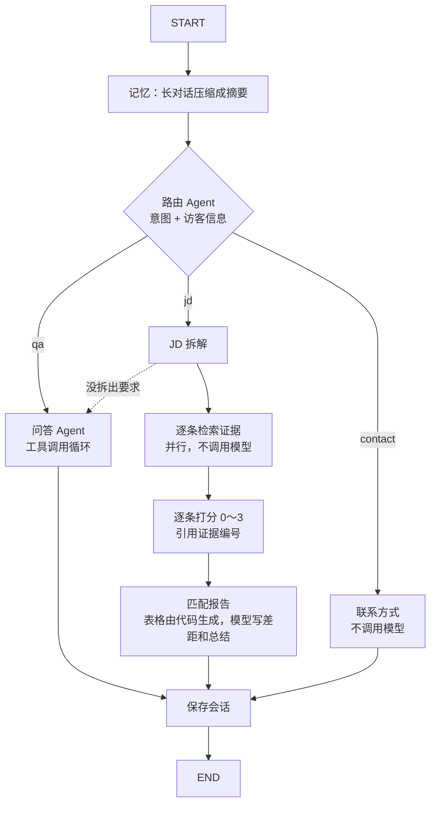

# ai-agent · 作品集 AI 助手

嵌在作品集首页 <http://47.117.29.74/> 上的问答助手：招聘方可以问我的工作经历、项目和技术细节，贴一段职位描述（JD）会得到逐条匹配报告。它用第一人称回答，讲项目细节时先检索知识库并附上 GitHub 链接，同时在页面上高亮相关的项目卡片；问到演示状态时会查询实时数据。

- **多 Agent + 工作流**：LangGraph 编排，路由 Agent 判断意图，分给问答 Agent、JD 匹配工作流或联系方式
- **RAG**：每个项目一篇项目说明 + 各项目 README / 设计文档（363 段），BM25 + 向量（bge-small-zh，本地 ONNX）混合检索，RRF 融合
- **记忆**：LangGraph SQLite checkpointer 按会话保存，长对话自动摘要压缩，记住访客的公司、岗位和关注点
- 模型 DeepSeek（`deepseek-flash`，OpenAI 兼容接口），全部流式；每个回答都能展开看执行路径、每步耗时、工具调用、token 和费用

## 架构

```
浏览器（首页 + agent.js）
   │  POST /agent/api/chat  →  text/event-stream
   ▼
Caddy 网关 ── /agent/* ──▶ ai-agent（FastAPI，127.0.0.1:8099）
                            ├─ LangGraph 状态图（下图） ──▶ DeepSeek API
                            ├─ 知识库：index.json（切块）+ vectors.npz（512 维向量）+ bge-small-zh（models/）
                            ├─ data/graph.db：checkpointer，每个会话一个 thread
                            └─ data/agent.db：每个问题一行，用于回看、限流、每日费用上限
```

## 状态图



`GET /agent/api/graph` 返回 LangGraph 生成的同一张图（Mermaid）。

| 节点 | 模型调用 | 做什么 |
|---|---|---|
| memory | 需要时 1 次 | 消息超过 `KEEP_MESSAGES`×2 条或 `SUMMARIZE_CHARS` 字时，把较早的消息压缩成摘要，只保留最近 `KEEP_MESSAGES` 条 |
| router | 1 次（JSON 模式） | 意图 qa / jd / contact；从消息里记下公司、岗位、关注点（没说的不猜） |
| qa_agent | 1～5 次 | 工具调用循环：`search_docs`、`get_project_status`、`get_vision_live`、`highlight_projects`；最后一步不给工具 |
| jd_parse | 1 次（JSON） | 拆成最多 8 条要求，标必须 / 加分，给出检索词 |
| jd_evidence | 0 | 每条要求并行混合检索 3 段，证据去重编号 E1、E2… |
| jd_score | 1 次（JSON） | 结合简历和证据逐条打分，只能引用给定的证据编号 |
| jd_report | 1 次 | 匹配度 = Σ 权重×分 / Σ 权重×3（必须 2，加分 1）；表格和证据链接由代码生成，模型只写"差距"和"总结" |
| contact | 0 | 给电话和邮箱（留言暂不开放） |
| finish | 0 | 把这一轮追加到历史；JD 只存拆解后的要求，不存原文 |

## RAG 知识库

| | |
|---|---|
| 内容 | `knowledge/projects/<id>.md`：我写的项目说明（架构、难点、我的贡献、并发与性能、关键数据），加各项目 README 和 `docs/*.md` |
| 切块 | 按 `##` / `###` 标题，超过 1800 字按段落再切；文档块链接到 GitHub 对应标题 |
| 关键词 | BM25，中文两字切分（不需要分词库），标题词权重 ×3 |
| 向量 | `BAAI/bge-small-zh-v1.5`（fastembed，ONNX Runtime，CPU），文档向量离线算好，查询向量化约 5 ms；余弦低于 0.45 的不要 |
| 融合 | RRF：每路取前 20，分数 = Σ 1/(60 + 名次)，不用调两种分数的比例 |
| 为什么混合 | "你怎么解决高并发"和文档里的"多路并发与性能"字面不同，靠向量；"OpenVINO 绑核""mFRR"这类专有名词靠关键词 |

几百段文本不需要向量数据库，numpy 矩阵乘就够了。没有模型文件或向量时自动退回纯 BM25（`/agent/api/health` 的 `search` 字段显示 `hybrid` 或 `bm25`）。

## SSE 事件

| 事件 | 数据 | 页面上 |
|---|---|---|
| `meta` | `session`、`search` | 存到 sessionStorage，下次提问带上 |
| `node_start` / `node_end` | 节点名、摘要、耗时 | 回答上方的步骤列表（记忆没压缩时不显示） |
| `memory` | `visitor` 或 `summary` | 抽屉顶部显示"已记住：公司 · 岗位 · 关注" |
| `text` | `delta` | 追加到回答，实时渲染 Markdown |
| `tool_start` / `tool_end` | 工具名、参数 / 摘要（含"关键词#2 语义#1"）、耗时 | 节点下面缩进显示 |
| `ui_action` | `{"type": "highlight", "projects": [...]}` | 高亮项目卡片 |
| `done` | 意图、执行路径、token、费用、耗时 | "查看执行过程" |
| `error` | 提示文字 | 红字提示；历史只在最后一个节点写入，出错的这一轮不会留下 |

## 设计要点

| 问题 | 做法 |
|---|---|
| 费用 | 系统提示词（规则 + 简历 + 项目摘要）固定不变，问答 Agent、JD 打分、JD 报告都把它放在第一条，共用 DeepSeek 前缀缓存（命中价约 1/50）；会话记忆放在后面的单独一条消息里，不破坏缓存；关闭思考模式 |
| JD 报告编造 | 拆解、检索、打分、出表分开做；打分只能引用检索到的证据编号，表格和链接由代码生成 |
| 回答编造 | 提示词单列"只说资料里有的"：排查过程、数字、在职状态等资料没写的一律不说；温度 0.3，JSON 调用温度 0 |
| 路由出错 | 意图不在三类里就当问答；判成 JD 但消息不到 40 字（没贴 JD）也当问答；JD 没拆出要求就转给问答 Agent |
| 被当成免费大模型用 | 只回答职业相关问题；单条最多 3000 字，每个会话最多 20 轮 |
| 刷接口 | 每个 IP 每小时 20 问、每天 60 问；全站每小时 200 问；全站每天费用超过 20 元就关闭。经 frp 转发时看不到访客 IP（都是 127.0.0.1），这时只按全站计数 |
| 提示注入 | 用户消息和工具结果都只当资料；工具全是只读的 |
| 思考模式 | 如果开启（`THINKING=enabled`），工具循环里助手消息连同 `reasoning_content` 原样回传，DeepSeek 要求这样，否则返回 400；跨轮的历史只存问题和最终回答 |
| 后端没起来 | 首页先请求 `/agent/api/health`，失败就不显示助手，首页其他部分照常 |

## 目录

```
app/main.py      接口、SSE、限流检查、会话锁
app/agent.py     运行状态图，把节点上报的事件转给页面，汇总 token 和费用
app/graph.py     LangGraph 状态图：各节点和连线
app/llm.py       DeepSeek 流式调用、JSON 模式、费用
app/tools.py     问答 Agent 的工具；retrieve() 也给 JD 工作流用
app/search.py    BM25 + 向量混合检索（RRF）
app/prompt.py    系统提示词和各节点的提示词
app/store.py     SQLite：对话记录、限流、费用
knowledge/       profile.md（简历）、projects.md（项目摘要）、projects/*.md（项目说明）、index.json、vectors.npz
scripts/build_index.py   生成 index.json 和 vectors.npz（第一次运行会下载向量模型到 models/）
tests/           pytest；fake_llm.py 是模拟的 DeepSeek 流式接口，按系统提示词扮演各个节点，测试不花钱
前端在网关仓库：site/agent.js、site/agent.css
```

## 运行

```bash
cp .env.example .env && vi .env            # 填 DEEPSEEK_API_KEY
docker build --network host -t ai-agent:latest . && docker compose up -d --force-recreate   # 监听 127.0.0.1:8099
# （docker compose build 在配置了 network: host 时需要额外权限，所以单独用 docker build）
```

网关（`/root/proj/gateway`）的 Caddyfile 里已经加了 `handle /agent/*`，改完执行
`docker compose exec caddy caddy reload --config /etc/caddy/Caddyfile`。

本地开发，不经过网关：

```bash
python -m venv .venv && .venv/bin/pip install -r requirements.txt pytest
DEV_SITE=../gateway/site .venv/bin/python -m app.main     # http://127.0.0.1:8099/ 就是首页
.venv/bin/python -m pytest -q                              # 13 项，用模拟模型
# 不花钱试页面：先 .venv/bin/python -m tests.fake_llm 8199，再加 DEEPSEEK_BASE_URL=http://127.0.0.1:8199
```

项目文档或项目说明更新后重建索引：`.venv/bin/python scripts/build_index.py`（约 40 秒，生成向量）。构建镜像前要先运行一次，把向量模型下载到 `models/`（镜像里离线加载）。

## 查看招聘方问了什么

```bash
sqlite3 data/agent.db "SELECT datetime(ts,'unixepoch','localtime'), json_extract(tools,'$.intent'), json_extract(tools,'$.visitor'), question, round(cost,4) FROM turns ORDER BY id DESC LIMIT 20"
```

## 费用

DeepSeek `deepseek-flash` 价格（元 / 百万 token，高峰时段；非高峰减半）：缓存命中 0.04，未命中 2，输出 8。
普通问题调用模型 3 次（路由 + 工具 + 回答），JD 匹配 4 次，联系方式 1 次；系统提示词约 1 万 token 基本都命中缓存，**每问约 0.001～0.03 元**（实测：问答 0.006～0.025，JD 匹配 0.018，联系方式 0.001）。页面上每个回答都显示实际费用。
